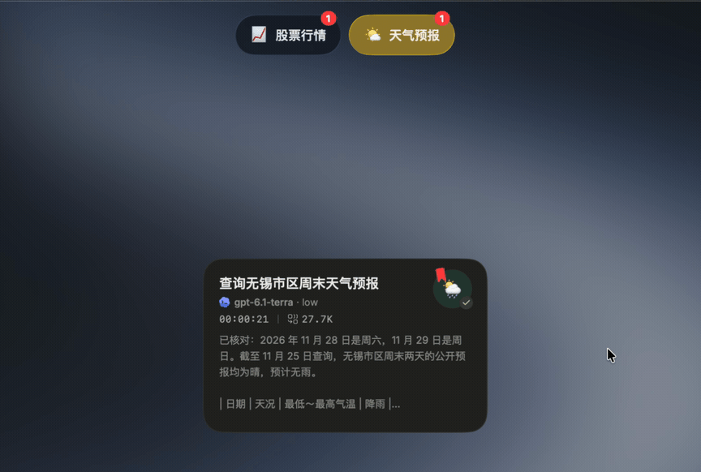
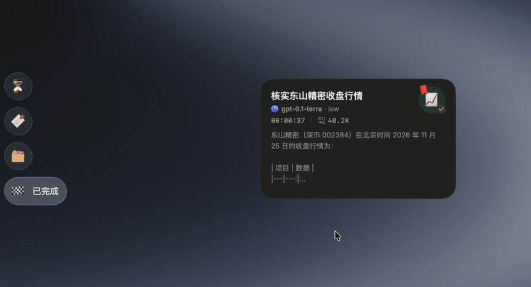

# Chief Bar 与标签操作指南

在 Chief 中按 **⌘K** 打开「**会话俯瞰**」。窗口底部带一双眼睛的短栏就是 Chief Bar。

## 单击 Chief Bar，输入请求

用鼠标左键点一下 Chief 的眼睛。短栏展开，光标出现在「输入消息…」里。输入请求后按 **Return**，或点击右端的向上箭头发送。消息发出后，短栏会收回。

## 长按 Chief Bar，和 Chief 说话

按住短栏半秒。输入框已经展开时，按住左侧的眼睛或任务图标。Chief 向右瞥一眼，表示正在连接。第一次使用时，按 macOS 提示允许麦克风访问。蓝色语音球从右端分离，就可以松手说话。

单击球会静音，球的蓝色变淡，Chief 的回复仍可听到。再点一次恢复收音。右键或按住 **Control** 点球可结束通话。**⇧⌘V** 也可以发起、取消正在建立的连接或退出。切换到任务页后，语音继续发给设置中选定的 Chief，文字仍发给当前任务。结束通话后，已接下的任务继续执行。

## 右键点击 Chief Bar，查看对话

右键点击同一双眼睛，也可以按住 **Control** 再点一下。对话会在输入框上方展开。右侧蓝色气泡是你发的消息，左侧是 Chief 的回复。

要接着聊，在底部输入并按 **Return**，对话会保持打开。按 **Esc** 可收起对话。

## 点击顶部标签，切换到另一个主题

点击窗口顶部的项目文件夹或收件箱标签。选中的按钮会亮起，下方的卡片也随之更新。动图里，点「**股票行情**」会看到股价查询卡片，点回「**天气预报**」就会看到周末天气卡片。

在会话俯瞰中，按 **⇧⌘[** 向左切换一项，按 **⇧⌘]** 向右切换一项。顶栏会滚动至选中项，到两端时停止。使用前先收起 Chief Bar 的输入框，或从阅读页、设置返回。若当前键盘布局需要 **Option** 才能输入方括号，可以点击顶部的文件夹或标签。

## 用左侧标签和状态筛选卡片

把指针停在左侧图标上可以看到名称，点一下就能筛选。顶部选中收件箱标签时，左侧可选「运行中」「未读」「全部状态」和「已完成」。顶部选中项目文件夹时，左侧列出项目自己的标签，以及「运行中」和「未读」。

也可以把指针移到卡片或画布空白处，用双指向上滑到列表的下一项，向下滑到上一项。上下滚动鼠标滚轮也能逐项切换。动图最后选中了「运行中」，画布显示「没有运行中的会话」。

[English guide](docs/chief-bar-and-tags.md)
