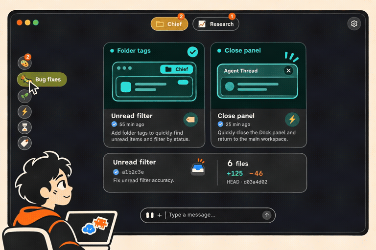
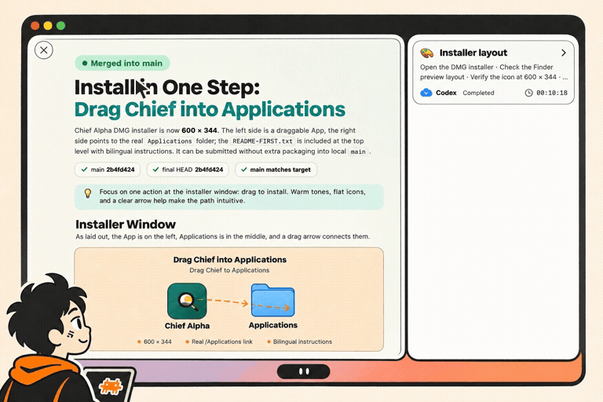

<h1 align="center">Chief</h1>

Chief brings your AI agents together and gets them cooking.

  
  
  
  

  <strong><a href="https://github.com/hupao-creator/Chief/releases/tag/v0.1.0-alpha.4">Download Alpha 4</a></strong> · <a href="docs/getting-started.md">Get started</a> · <a href="LICENSE">Apache 2.0</a>

## Attention Is All We Need

Three agents need your attention. You’re still halfway through the first reply. When you switch away from unfinished work, some of your attention can stay with it. This is called **attention residue**. [Leroy, 2009](https://doi.org/10.1016/j.obhdp.2009.04.002)

### Tags keep one topic in view

Chief groups each project’s conversations under **up to five tags**. Switch from *Bug fixes* to *Design*, and Overview shows the tasks for that topic.

### Super Threads bring the results together

Read **one report** across related conversations. When you want to see how an agent reached a result, open its source conversation on the right.

## What you get

- **A fully native Mac app.** Built with **SwiftUI and AppKit**, Chief comes in a **26 MB** download.
- **Your agents in one place.** Bring **Codex, Claude, Pi Agent, and OpenCode** together with the accounts and models you already use.
- **One place to delegate.** Give Chief a task, and it can coordinate agents **across harnesses and models**. Ask Codex to implement a change and Claude Code to review it.
- **Live task overview.** See what’s running, which files changed, and **which agents are waiting for you**. Filter by project folder or tag to focus on one part of your work.
- **Designed around Liquid Glass.** Translucent controls keep your work in view as you move between the task overview and individual conversations.
- **Your CLI setup stays yours.** Chief connects to your agents one session at a time, **without rewriting your user or project settings** or installing global hooks or plugins.

## License

Chief is licensed under the [Apache License 2.0](LICENSE).
Copyright 2026 hupao-creator.

Third-party materials retain their licenses and attribution notices, including
[agent skills](.agents/skills/LICENSE),
[fonts and icons](app/macos/Sources/Shared/PluginUI/Resources/), and
[Unicode data](internal/services/taglabel/UNICODE-LICENSE.txt).
