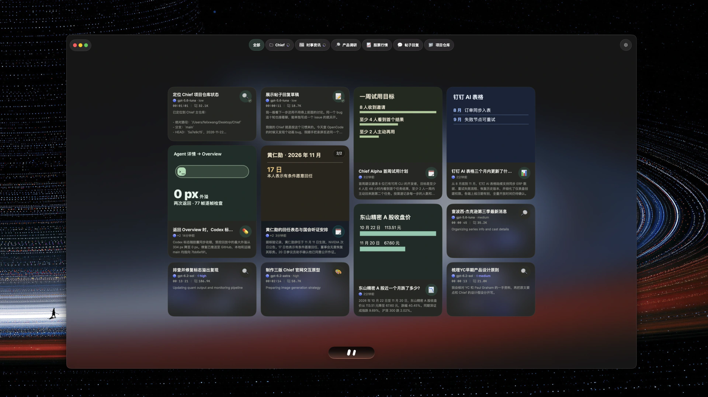
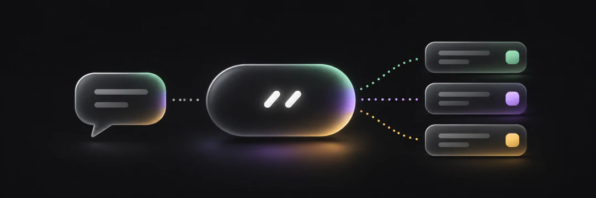

<h1 align="center">Chief</h1>

Chief brings your AI agents together and gets them cooking.

  
  
  
  

  <strong><a href="https://github.com/hupao-creator/Chief/releases/tag/v0.1.0-alpha.4">Download Alpha 4</a></strong> · <a href="docs/getting-started.md">Get started</a> · <a href="LICENSE">Apache 2.0</a>

The active task shows the latest agent activity and a summary of file changes. Select the screenshot to view it at full size. [Watch the Overview demo (MP4, 6.5 sec) →](design/overview-readme-demo.mp4)

## What you get

- **Your agents in one Mac app.** Use Codex, Claude, Pi Agent, and OpenCode with the accounts and models you already use on your Mac.
- **One place to delegate.** Give Chief a task and the files it needs. Chief can answer directly or assign the work to an agent you’ve enabled. [Working with Chief](docs/working-with-moku.md)
- **Live task overview.** Filter by folder or tag to see what’s running, which files changed, and which agents need an answer or permission to proceed. [Overview](docs/overview.md)
- **Conversations you can pick up again.** Revisit an earlier run, send a follow-up, or branch the conversation when the agent supports it. [Agent conversations](docs/task-conversations.md)
- **Reports with sources.** A Super Thread summarizes completed work in a project and links back to the conversations behind it. [Super Threads](docs/reports-tags-and-changes.md#see-the-work-behind-a-super-thread)
- **Feedback right on the page.** Open a web page beside a conversation, mark what you want changed, and send the screenshot and your comment to the agent. [Sidecards](docs/sidecards.md#mark-up-a-web-page-and-send-feedback)

## Agent roles

<table width="100%">
  <thead>
    <tr>
      <th width="33%" align="center"><a href="docs/working-with-moku.md">Chief Agent</a></th>
      <th width="33%" align="center"><a href="docs/reports-tags-and-changes.md#group-tasks-with-tags">Tag Agent</a></th>
      <th width="33%" align="center"><a href="docs/reports-tags-and-changes.md#see-the-work-behind-a-super-thread">Super Thread Agent</a></th>
    </tr>
  </thead>
  <tbody>
    <tr>
      <td align="center"></td>
      <td align="center"></td>
      <td align="center"></td>
    </tr>
    <tr>
      <td align="center">Assign work to agents.</td>
      <td align="center">Group tasks by topic.</td>
      <td align="center">Sum up work with source links.</td>
    </tr>
  </tbody>
</table>

## License

Chief is licensed under the [Apache License 2.0](LICENSE).
Copyright 2026 hupao-creator.

Third-party materials retain their licenses and attribution notices, including
[agent skills](.agents/skills/LICENSE),
[fonts and icons](app/macos/Sources/Shared/PluginUI/Resources/), and
[Unicode data](internal/services/taglabel/UNICODE-LICENSE.txt).
