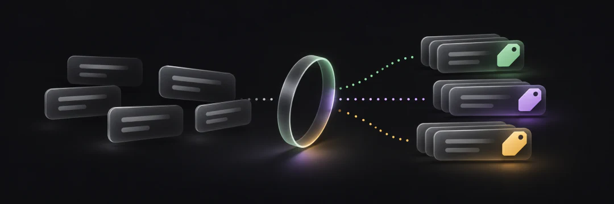
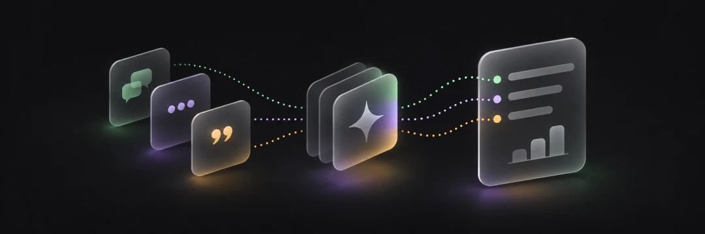

# Chief

  

  <strong>A native Mac workspace for coordinating AI agents.</strong>

  <a href="#get-started">Get started</a> · <a href="docs/README.md">Product guide</a> · <a href="LICENSE">Apache 2.0</a>

  Apple silicon · macOS 26+ · Invited alpha · <a href="https://github.com/hupao-creator/Chief/releases/tag/v0.1.0-alpha.2">Alpha 2 download (about 31 MB)</a>

---

Chief brings Codex, Claude, Pi Agent, and OpenCode into one workspace.
Talk to the **Chief** assistant to coordinate work, then open each task's conversation
to follow the work and give it more direction.

Select the screenshot to open its original file. The Overview grid rearranges as task cards update. [Watch the Overview demo (MP4, 6.5 sec) →](design/overview-readme-demo.mp4)

- **Ask once, coordinate across agents.** Give Chief a task, attach files, and include the full path of any project folder Chief should use. Chief can answer directly or assign work to the agents you've enabled. [Working with Chief →](docs/working-with-moku.md)
- **See what needs you.** Overview uses a bento box design to show task status, questions, and permission requests on cards of different sizes. The canvas grows with your work for the feel of infinite horizontal scrolling as you browse from the first column to the last. Filter by folder or tag, then open a conversation to step in. [Overview →](docs/overview.md)
- **Read results and keep going.** Read completed replies, revisit earlier runs, send a follow-up, or branch from an earlier run when the agent supports it. [Agent conversations →](docs/task-conversations.md)
- **Connect the work.** Super Thread Agent prepares Super Threads with links back to source conversations. Git task cards can show branch and change summaries. [Super Threads and file changes →](docs/reports-tags-and-changes.md#see-the-work-behind-a-super-thread)
- **Give feedback beside the work.** Open a web page in a sidecard, annotate an element or area, and send the screenshot and comment to the current agent conversation. [Sidecards →](docs/sidecards.md)

Chief uses the agent CLIs you’ve already configured on your Mac, with their
existing accounts, models, and credentials. Chief connects its tools within the
session without rewriting user or project configuration, registering global
hooks, or installing global plugins.

The interface uses SwiftUI and AppKit, backed by a Go service.

## Agent roles

<table width="100%">
  <thead>
    <tr>
      <th width="33%" align="center"><a href="docs/working-with-moku.md">Chief Agent</a></th>
      <th width="33%" align="center"><a href="docs/reports-tags-and-changes.md#group-tasks-with-tags">Tag Agent</a></th>
      <th width="33%" align="center"><a href="docs/reports-tags-and-changes.md#see-the-work-behind-a-super-thread">Super Thread Agent</a></th>
    </tr>
  </thead>
  <tbody>
    <tr>
      <td align="center"></td>
      <td align="center"></td>
      <td align="center"></td>
    </tr>
    <tr>
      <td align="center">Assign work to agents.</td>
      <td align="center">Group tasks by topic.</td>
      <td align="center">Sum up work with source links.</td>
    </tr>
  </tbody>
</table>

---

## Get started

Chief is available as an **invited alpha** for Macs with Apple silicon and
macOS 26 or later. Open [Chief Releases](https://github.com/hupao-creator/Chief/releases)
and choose the alpha version from your invitation. Under **Assets**, download the
arm64 disk image, `SHA256SUMS`, and `READ-ME-FIRST.txt`.

1. Drag **Chief Alpha.app** from the disk image into **Applications**, then open it. The alpha is not notarized; a trusted download may need the per-app **Open Anyway** exception in **System Settings → Privacy & Security**.
2. Install and configure at least one supported agent on your Mac: Codex, Claude, Pi Agent, or OpenCode. Chief checks which are ready during setup. Each service determines model access and costs.
3. Choose the agent that will serve as Chief and the agents it can assign work to. Finish setting up Tag Agent and Super Thread Agent, then click **Start using Chief**.
4. Describe your task in **Type a message…**. If the task uses a project folder, include its full path. Send the request and open its task card when Chief creates one.

No Go, Xcode, or Apple developer membership is needed to use the alpha.
Updates are manual, and alpha app data may be incompatible between versions.
Follow the accompanying installation guide when updating. Chief follows your
Mac's appearance and opens in Simplified Chinese when Chinese is the primary
system language. For all other primary languages, Chief uses English.

[Full installation and first-request guide →](docs/getting-started.md)

## Product guide

[Working with Chief](docs/working-with-moku.md) ·
[Overview](docs/overview.md) ·
[Agent conversations](docs/task-conversations.md) ·
[Tags, Super Threads, and file changes](docs/reports-tags-and-changes.md) ·
[Sidecards](docs/sidecards.md) ·
[Settings](docs/settings.md)

## License

Chief is licensed under the [Apache License 2.0](LICENSE).
Copyright 2026 hupao-creator.

Third-party materials retain their licenses and attribution notices, including
[agent skills](.agents/skills/LICENSE),
[fonts and icons](app/macos/Sources/Shared/PluginUI/Resources/), and
[Unicode data](internal/services/taglabel/UNICODE-LICENSE.txt).
