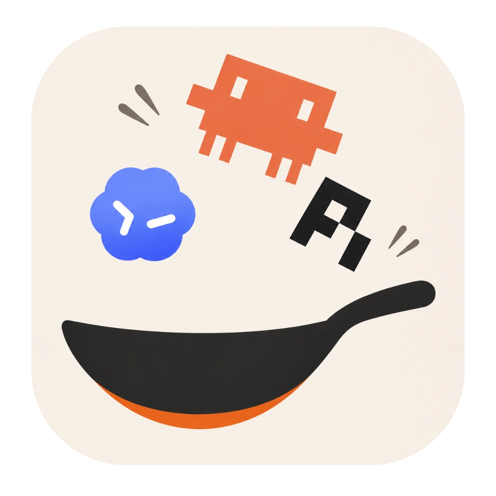
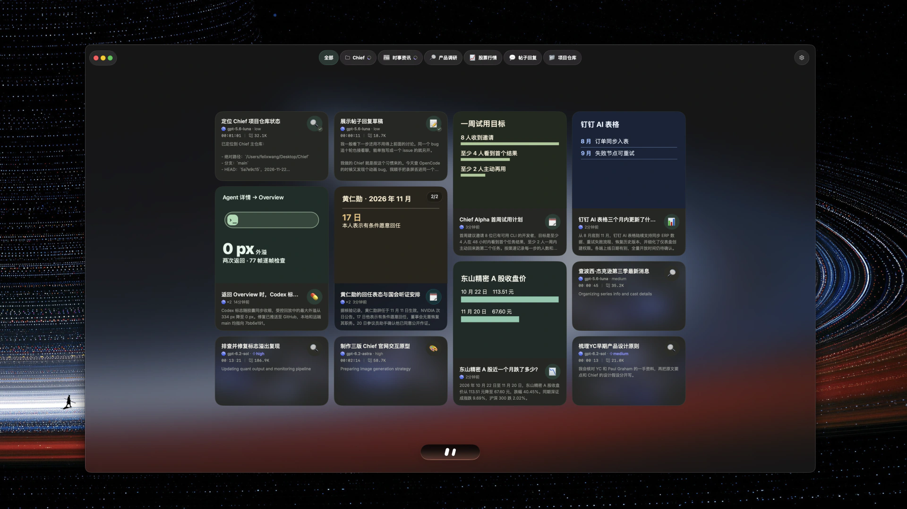
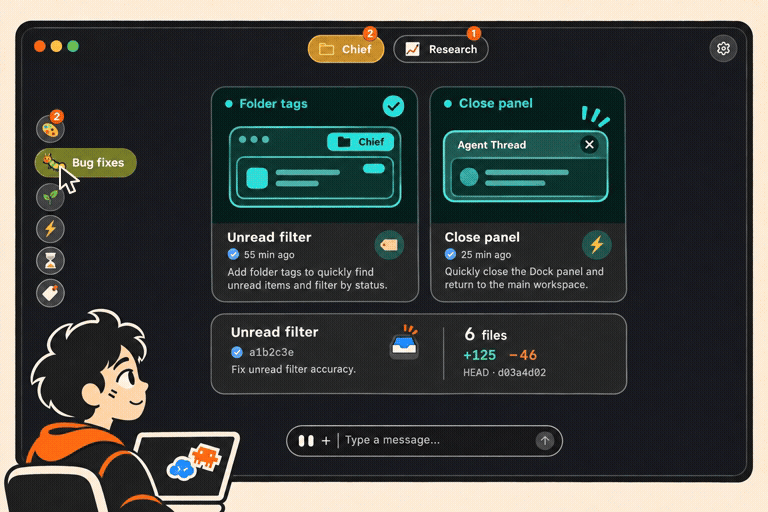
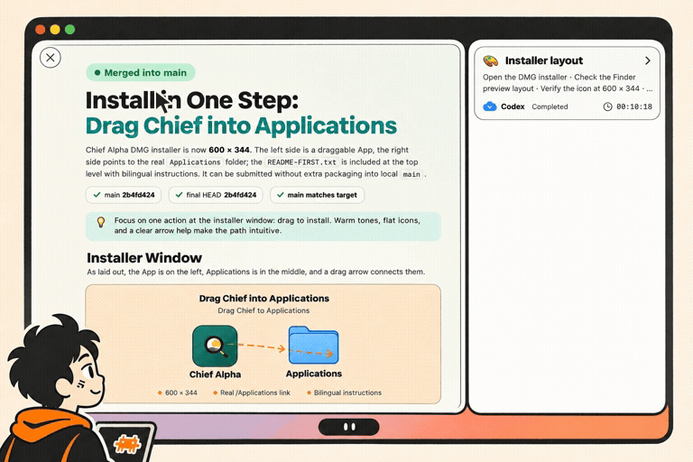

<h1 align="center">Chief</h1>

<a href="README.md">English</a> / <strong>简体中文</strong>

Chief 把你的 AI Agent 聚到一起，让它们协作开工。

  
  
  
  

  <strong><a href="https://github.com/hupao-creator/Chief/releases?q=draft%3Afalse">下载最新版本</a></strong> · <a href="docs/getting-started.md">快速上手（英文）</a> · <a href="LICENSE">Apache 2.0</a>

## 我们需要的只是注意力

三个 Agent 都在等你，你却还没读完第一条回复。从一项尚未完成的工作切到另一项时，你的一部分注意力可能还留在前一项工作上。这种现象叫作**注意力残留**。 [Leroy, 2009](https://doi.org/10.1016/j.obhdp.2009.04.002)

### 用标签专注于一个主题

Chief 用**最多五个标签**归类每个项目中的对话。从 *Bug fixes（缺陷修复）* 切换到 *Design（设计）*，概览便会显示该主题下的任务。

### 用超级线程汇总结果

在**一份报告**中阅读相关对话的结果。想了解某个 Agent 是如何得出结果的，可以在右侧打开对应的原始对话。

## 功能一览

- **原生 Mac 应用。** Chief 使用 **SwiftUI 和 AppKit** 构建，面向搭载 Apple 芯片的 Mac。
- **集中使用你的 Agent。** 用你已有的账号和模型，把 **Codex、Claude、Pi Agent、OpenCode 和 Antigravity** 聚到一起。
- **统一委派任务。** 把任务交给 Chief，它可以协调**不同 Harness 和模型**的 Agent。比如，让 Codex 实现一项改动，再让 Claude Code 审查。
- **实时任务概览。** 查看哪些任务正在运行、哪些文件有变更，以及**哪些 Agent 正在等你**。按项目文件夹或标签筛选，专注于当前的工作。
- **采用 Liquid Glass 设计。** 在任务概览与单个对话之间切换时，半透明控件让工作内容始终可见。
- **保留你的 CLI 配置。** Chief 逐个会话连接 Agent，**无需改写用户或项目设置**，也无需安装全局钩子或插件。

## 许可证

Chief 采用 [Apache License 2.0](LICENSE) 许可协议。
Copyright 2026 hupao-creator.

第三方材料保留各自的许可证和署名声明，包括
[Agent 技能](.agents/skills/LICENSE)、
[字体和图标](app/macos/Sources/Shared/PluginUI/Resources/)和
[Unicode 数据](internal/services/taglabel/UNICODE-LICENSE.txt)。
