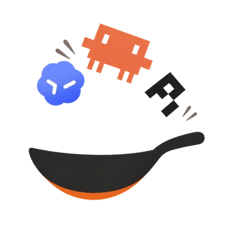

# Chief logo 加载动效

各段动效取自同一张[应用图标原画](../../design/chief-logo.webp)。下表并排展示动作草图。点开名称可查看 384 × 384 的透明循环 WebP。动画按 25 fps 采样。

| [颠勺](toss.webp) | [三拍接力](relay.webp) | [锅底余火](ember.webp) |
| :---: | :---: | :---: |
|  |  |  |
| 2.4 秒 · 60 帧 | 1.8 秒 · 45 帧 | 3.6 秒 · 90 帧 |

- **颠勺**以锅柄为转轴。锅沿先下压再上挑，三个 Agent 错开离锅，达到最高点时展开成原图构图。落回锅沿时，锅身轻轻回弹。
- **三拍接力**固定锅身，按 Codex、Claude Code、Pi 的顺序，每隔 0.6 秒起一拍。轮到的 Agent 上移并恢复全色，其余保留轮廓。
- **锅底余火**固定锅和三个 Agent，把移动的暖光限制在原图的橙色锅底内。两缕热气错开升起，淡出后各自重新出现。

## 颠勺的四种抛接方式

| [A · 低抛双颠](toss-variants/double.webp) | [B · 高抛慢接](toss-variants/high.webp) | [C · 沿锅翻炒](toss-variants/rim.webp) | [D · 逐个抛接](toss-variants/solo.webp) |
| :---: | :---: | :---: | :---: |
|  |  |  |  |
| 1.6 秒 | 3.2 秒 | 2.4 秒 | 3.2 秒 |

双颠的两次抛接共用一次短停顿。高抛在顶点放慢，使三个标记充分展开。沿锅翻炒让每个标记轮流经过同一条弧线。逐个抛接时，其余两个标记贴着锅沿随锅身起伏。

## 原生加载标记

启动、打开对话和其他整页加载界面共用颠勺动效。锅和三个角色取自应用图标原画。锅口随锅柄下压、上挑，角色依次离锅，落回锅口后锅身轻轻回弹。开启「减少动态效果」时，三个角色停在锅中。启动状态由 [NativeRuntimeSurface](../../app/macos/Sources/Host/Shell/NativeRuntimeSurface.swift) 控制。

[原速过渡 demo](evidence/transition.mp4) 是 900 × 560 pt 原生工作区的窗口录屏。启动界面和 Overview 空态使用同一只锅。目录就绪后，锅接住角色，移到标题上方。角色从锅沿后以睡姿露出，筛选栏和 Dock 同步淡入。[动效实现](../../app/macos/Sources/Host/Overview/NativeOverviewStatusPresentation.swift)

[原生回放](Replay.swift) 使用临时 profile，在已保存 Running 筛选的真实工作区注入目录。空态样本含一个空闲任务。回放录制至少两次颠勺，检查减少动态效果的两张加载静帧，在恢复动效后从加载直接进入空态，并核对标题和两端锅身的可见宽度。FFmpeg 读取深色窗口录像最后 2.2 秒的每一帧，在中心右侧 105 pt 处沿竖线检查锅柄。每帧应有上下两条亮边，期间上移至少 12 pt，单帧位移不超过总位移的三分之一。逐帧结果保存在 `handle-rows.json`。

独立场景覆盖浅色 680 × 480 pt 窗口的减少动态效果、运行中任务卡、首次设置、目录准入失败后的 Reconnect 和零会话 landing。输出目录包含各自的截图、结果、版本及隔离记录。这些场景通过 fixture 驱动目录准入，真实网络连接和服务重试需要另行验证。

在有图形会话、Swift 依赖和 FFmpeg 的 Mac 上运行：

```sh
swift build --package-path app/macos --product Chief
python3 demos/chief-logo-loading/replay.py .build/loading-replay/current
```
