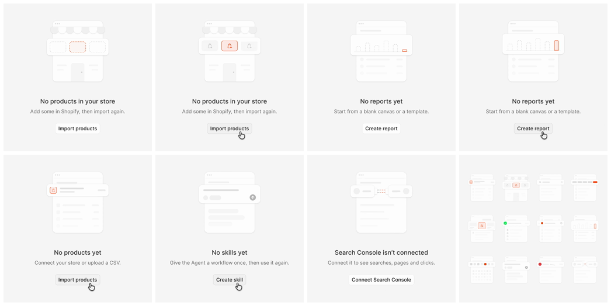

# Chief 空状态原生比较

在同一 macOS 窗口比较现行空态和带最近会话的空态。两个版本共用生产睡锅、标题、顶部范围和 Chief Bar。Demo 与正式 Overview 复用同一个最近会话列表。最近会话共用一块原生 Liquid Glass 面板，每行显示真实 Harness logo、Thread 标题和相对时间。系统启用「降低透明度」时使用 Chief 的不透明回退。

## 运行

需要 Apple Silicon、macOS 26 及以上、带 macOS 26 SDK 的 Xcode 和 Python 3。从仓库根目录构建，再手动打开生成的 App。

```sh
python3 demos/empty-state-native-candidates/build.py
open ".build/empty-state-native-candidates/Chief Empty States.app"
```

左上在 **Current** 和 **Recent threads** 之间切换。右上 **Scenario** 或左侧筛选可切换 **Running** 和 **Unread**。右上菜单可换外观，或用 **Reset preview** 恢复样例阅读记录。

- **No running conversations** 下面显示当前 Chief 文件夹中最近完成的三个 Thread。时间列取完成时间，最近完成的排在最上面。
- **No unread conversations** 下面显示同一文件夹中最近读过的三个 Thread。时间列取阅读时间，两个场景的样例顺序不同。
- 点击一行可打开该 Thread 的示例请求和回复，再返回原筛选。演示里重读会更新 **Recently read** 的顺序。没有相应记录时保持现行空态。

## 原视频观察

通过原帖 ID 获取媒体元数据，从 X 的 CDN 取得 H.264 视频并逐帧抽样。实际下载版本为 1080 × 1080、60 fps、17.183 秒。[X 原帖](https://x.com/_heyrico/status/2125666357266239569/video/1) · [原始 MP4](https://video.twimg.com/amplify_video/2125666330728955904/vid/avc1/1080x1080/YLs-P4wWLEv1lO4j.mp4?tag=16)



由左至右、由上至下是 **0.25、1.05、3.03、4.23、6.17、9.60、11.00、15.30 秒**。原始 MP4 的 SHA-256 为 `27eed659bc4b01852e15e52b64751535367ca8dec3b269c9b8996f7fe75ce1ed`。抽帧命令如下，`reference.mp4` 指上面的 CDN 文件。

```sh
ffmpeg -i reference.mp4 \
  -vf "select='eq(n,15)+eq(n,63)+eq(n,182)+eq(n,254)+eq(n,370)+eq(n,576)+eq(n,660)+eq(n,918)',scale=254:254,tile=4x2:margin=6:padding=6:color=white" \
  -frames:v 1 reference-frames.png
```

- **构图与层次**。浅灰背景上，白色微型窗口承载更清晰的前景条。下方依次是深色标题、灰色句子和一个按钮。商店、报表、技能、连接共享位置和比例，前景分别用槽位、柱状图、输入框和连接线表达缺少的东西。
- **动效与指针**。0.25 到 1.05 秒，指针移到导入按钮附近时，商店的虚线空槽显出袋形图标，只有中槽使用橙色。3.03 和 4.23 秒，报表右端的橙色柱从很短变高，正文留在原位。9.60 秒能看到技能输入框内的橙色光标，11 秒连接示例把强调色留给两端之间的虚线。画面记录了指针位置和局部变化，具体事件绑定未知。
- **迁移到 Chief**。把下一步放在空态标题下方。这里把可打开的近期 Thread 本身作为入口，用户可以先看到标题和时间再选。

## 产品依据和范围

[Overview](../../app/macos/Sources/Host/Overview/README.md#unread-bookmarks) 按当前范围计算 Running 与 Unread。[完成时间](../../app/macos/Sources/Shared/PluginAPI/HarnessThread.swift)来自最近一次成功且已结束的执行。[已读回执](../../app/macos/Sources/Host/Overview/NativeThreadReadHistory.swift)标记某个内容版本已读。重复阅读同一版本不会刷新回执，批量标为已读也会生成回执。Demo 在内存中保存样例阅读时间。正式 Overview 使用实际阅读时写入本机 profile 的阅读时间。[生产路径](../../app/macos/Sources/Host/Overview/README.md#recent-threads-at-empty-status-filters)

## 无头预览

构建后直接用 SwiftUI `ImageRenderer` 导出八张 PNG，包括原版与最近会话版、Running 与 Unread、浅色与深色。睡锅使用生产图片的静态帧，列表导出使用静态表面。原生 Liquid Glass 的折射、顶栏、Chief Bar 和真实交互在窗口中验收。

```sh
".build/empty-state-native-candidates/Chief Empty States.app/Contents/MacOS/Chief Empty States" \
  --export-previews ".build/empty-state-native-candidates/glass-thread-previews"
codesign --verify --deep --strict ".build/empty-state-native-candidates/Chief Empty States.app"
```

构建、签名和离屏效果属于静态检查。实际点击、阅读顺序更新、焦点和窗口动效仍需实机验收。
