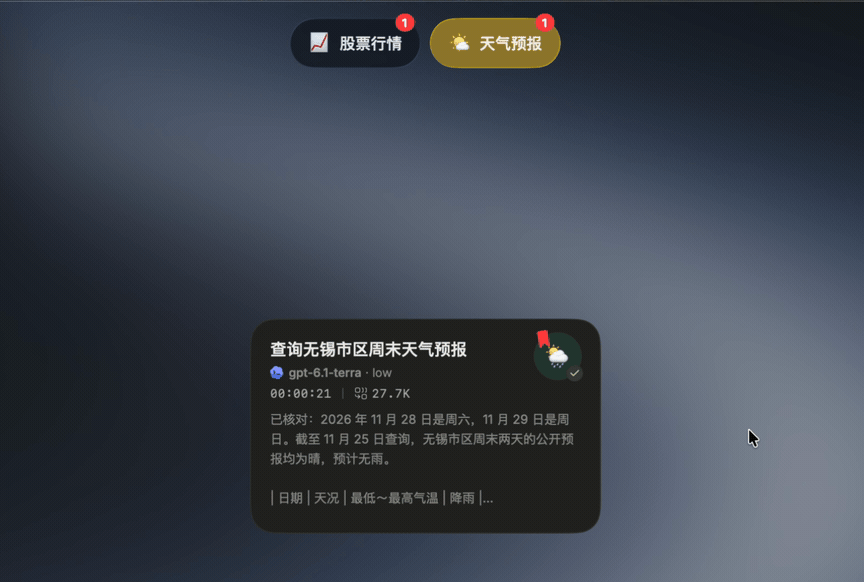
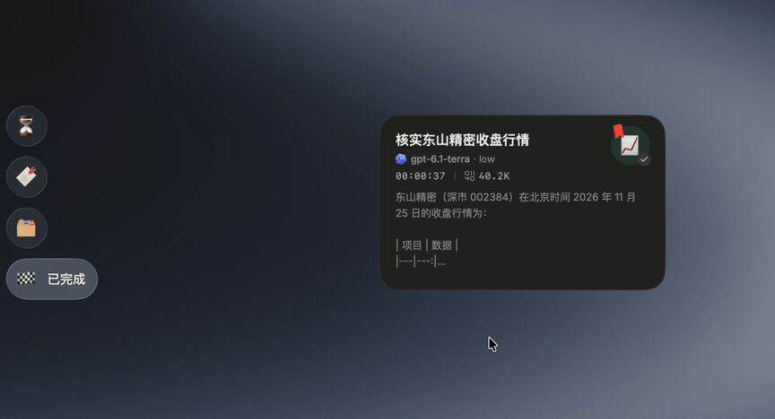

# Use Chief Bar and switch tags

Press **⌘K** to open **Overview**. Look for the pair of eyes at the bottom of the window. That’s Chief Bar. The clips show the Simplified Chinese interface.

[简体中文版](../GUIDE.zh-CN.md)

## Click Chief Bar to type a request

Click Chief’s eyes once. The bar expands and the cursor appears in **Type a message…**. Type your request, then press **Return** or click the up arrow to send it. The bar folds back to the eyes.

## Hold Chief Bar to speak

Press and hold the bar for half a second. If the text box is open, hold the eyes or agent icon at its left edge. Chief glances to the right while it connects. The first time, allow Chief to use your microphone when macOS asks. When the blue orb separates from the bar, you can release the mouse and speak. The call continues until you end it.

Click the orb to mute your microphone. Its blue color fades while you’re muted. Click again to speak, or right-click the orb to end the call. **Control-click** also ends it. **⇧⌘V** starts Voice Mode from the bar, cancels a pending connection or ends an active call.

Voice goes to the **Chief Agent** selected in Settings, even when you open another task. Typing in that task still sends to the task, and opening Voice Mode keeps your draft and selection. You may hear a brief acknowledgement. Chief’s replies appear as text. Right-click Chief Bar to read them in the conversation. Ending the call lets accepted work continue. [Choose your Chief Agent](settings.md)

If transcription stalls for 30 seconds on one phrase, Chief skips it and keeps listening. You can say your next sentence in the same call. To check which requests reached Chief, open the Chief conversation and repeat any missing request.

Voice Mode needs a microphone, audio output and a Codex installation signed in with a ChatGPT account that supports realtime voice. If microphone access was denied, turn on **Chief** in **System Settings → Privacy & Security → Microphone**, then hold the bar again.

## Right-click Chief Bar to chat

Right-click the eyes, or hold **Control** and click. Your conversation opens above the input field. Your messages appear in blue on the right and Chief’s replies appear on the left. Type a follow-up and press **Return** to keep chatting in the panel. Press **Esc** to close it.

## Switch folders and tags at the top

Click a project folder or an Inbox tag in the top row. The button you choose lights up and the cards below change. In the clip, clicking **股票行情** (stock prices) brings up a stock quote task. Clicking **天气预报** (weather forecast) brings back the weekend forecast.

You can click a folder or tag while a compact reply or the Chief conversation is visible. The cards switch and the message stays visible. Click an empty part of Overview to dismiss it.

From Overview, press **⇧⌘[** to move one space left or **⇧⌘]** to move one space right. The top row scrolls to show your selection, and the shortcuts stop at either end. Close Chief Bar’s input or return from a reader or Settings before using these shortcuts. If your keyboard layout requires **Option** to type brackets, click the folder or tag at the top.

## Switch tags and filters on the left

Hover over an icon on the left to see its name, then click it to filter the cards. In a project folder, you can choose one of its tags, **Running**, or **Unread**. With an Inbox tag selected at the top, the choices are **Running**, **Unread**, **All statuses**, and **Completed**.

To cycle through these choices as shown below, move the pointer over a card or an empty part of the canvas. Swipe up with two fingers for the next option down the list, or down for the one above. On a supported trackpad, you may feel a tap as the selected label changes. A vertical mouse wheel also steps through the list. The selected label stays open. If nothing is running in the current view, **Running** shows **No running conversations**. Use **Recently completed** below it to revisit a finished task when one is available. [Find your conversations in Overview](overview.md)

[Back to the product guide](README.md)
